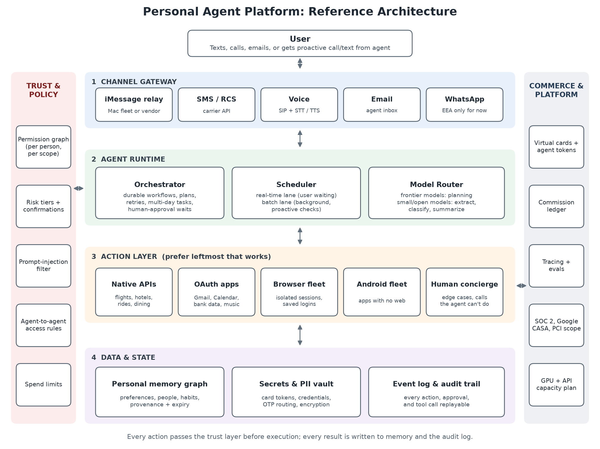

# Open Personal Agent

**An open playbook for building AI personal agents you can text, call, or email, and that take real actions on your behalf. Published so that no single company controls the personal-agent layer.**

Personal agents are becoming the front door to people's money, calendars, inboxes, and relationships. In 2026 one startup went from founding to a $10B valuation in about a year by shipping one ([Reuters](https://www.reuters.com/pt/tecnologia/YJK5QKMPVRO23EHRHIOACCOZZM-2026-09-28)), and Meta launched its own competing agent, Muse ([Fortune](https://fortune.com/2026/09/30/noah-shinn-instinct-ai-assistant-meta-muse-alexandr-wang-tech-series-c-ai-agent-mark-zuckerberg/)). If the knowledge of how to build these systems stays inside a few companies, so does control over what agents are allowed to do, whom they work for, and who owns the memory they build about each of us.

This repository shares that knowledge openly: the architecture, an open-source-first stack, the open standards to build on, the safety defaults that should ship with every agent, and a draft format for **user-owned agent memory**.

## Principles

1. **Users own their memory.** Preferences, history, and relationships an agent learns belong to the user and must be exportable and deletable. See the [Open Memory Format](spec/open-memory-format/).
2. **Open standards over private integrations.** Tools via MCP, agent-to-agent via A2A, payment consent via AP2, checkout via UCP or ACP. See [Standards](docs/03-standards.md).
3. **Open source first, vendors optional.** Every layer has an open-source option; commercial services are plug-ins, not dependencies. See [Open Stack](docs/02-open-stack.md).
4. **Safe by default.** Agents that hold cards and logins must ship with risk tiers, confirmations for money, and a full action log. See [Trust and Safety](docs/04-trust-and-safety.md).
5. **Honest about gatekeepers.** Code is not the only control point. Messaging platforms, payment rails, and compute are, too. See [Channels and Gatekeepers](docs/05-channels-and-gatekeepers.md).

## The Playbook

| # | Document | What it covers |
| --- | --- | --- |
| 0 | [Why open](docs/00-why-open.md) | Where control concentrates in the personal-agent market and how openness counters it |
| 1 | [Reference architecture](docs/01-architecture.md) | Four layers plus trust and commerce; the action ladder; one request end to end |
| 2 | [Open stack](docs/02-open-stack.md) | Open-source component for every layer, with license and commercial alternates |
| 3 | [Standards](docs/03-standards.md) | MCP, A2A, AP2, UCP, ACP, x402, and the gaps no standard covers yet |
| 4 | [Trust and safety](docs/04-trust-and-safety.md) | Risk tiers, confirmations, prompt-injection defense, secrets vault, audit log |
| 5 | [Channels and gatekeepers](docs/05-channels-and-gatekeepers.md) | iMessage, WhatsApp, SMS, voice, email; compliance gates such as Google CASA |
| 6 | [Build plan](docs/06-build-plan.md) | Phased plan with exit criteria, team roles, and unit-economics checks |

## Specs (drafts, contributions welcome)

- [Open Memory Format v0.1](spec/open-memory-format/): a portable JSON schema for what an agent knows about a user, with provenance, consent scope, and expiry on every fact.
- [Risk Policy v0.1](spec/risk-policy/): a declarative policy file mapping agent actions to risk tiers and confirmation rules.

## Status

v0.2 ships a working [reference app](app/): a personal agent you text that plans with a frontier model, enforces the Risk Policy on every action, asks for signed approval before spending money or acting as you, defends against prompt injection from email, and exports memory as OMF. It runs on sample calendar, inbox, and flight data, and its bookings, cards, and email sends are simulated. The SMS webhook is built but not yet live-tested. See [app/README.md](app/README.md) for what is real and what is sample, and the [Roadmap](ROADMAP.md) for what comes next.

## Contributing

Corrections, new vendor and project entries, spec proposals, and implementation work are all welcome. Read [CONTRIBUTING.md](CONTRIBUTING.md) first. Security issues: see [SECURITY.md](SECURITY.md).

## Disclaimer

This project is independent and is not affiliated with, endorsed by, or derived from any company named in it, including Instinct (Spear Street Technology) or Meta. Descriptions of commercial products are based on public reporting and vendor documentation as of October 2026 and may change. Nothing here is legal advice; payments, telephony, and data-privacy rules vary by jurisdiction.

## License

Code and specs are licensed under [Apache 2.0](LICENSE). Documentation is licensed under [CC BY 4.0](LICENSE-docs.md).
